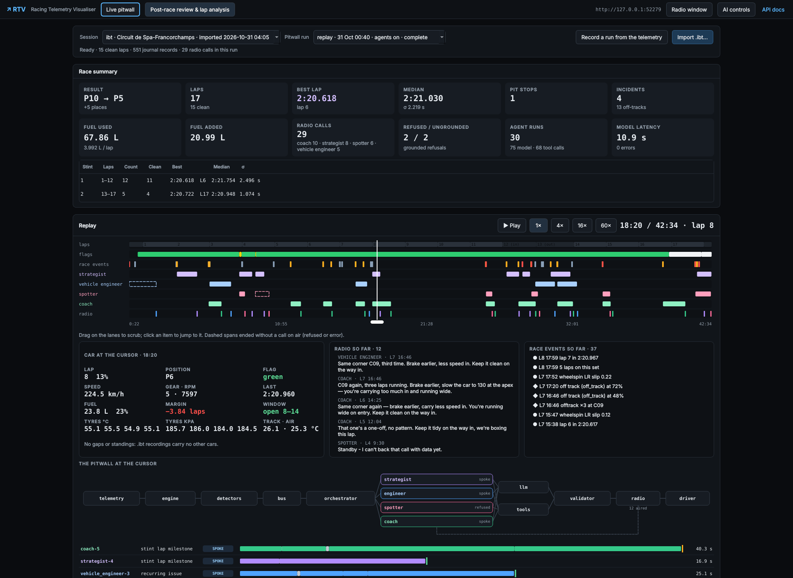
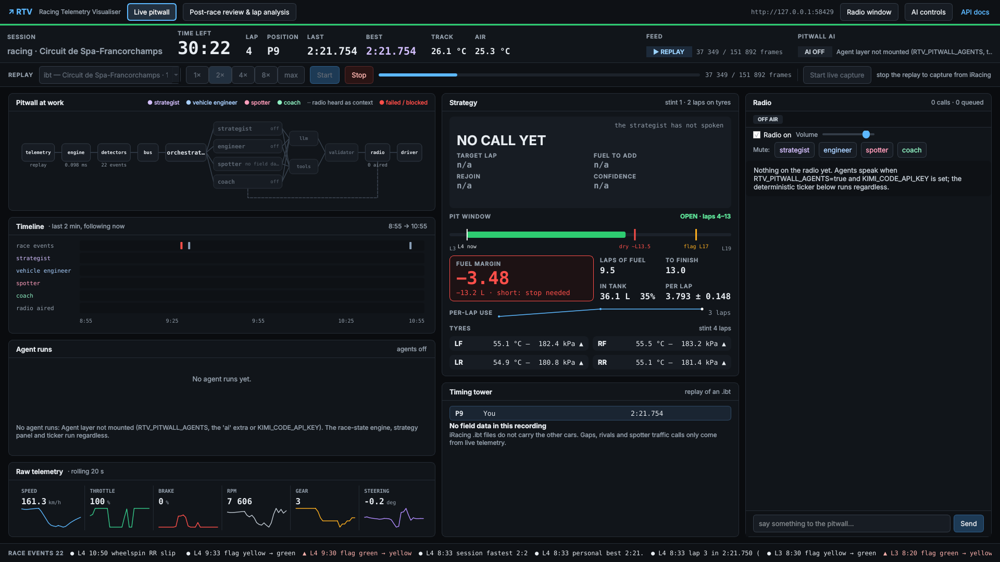
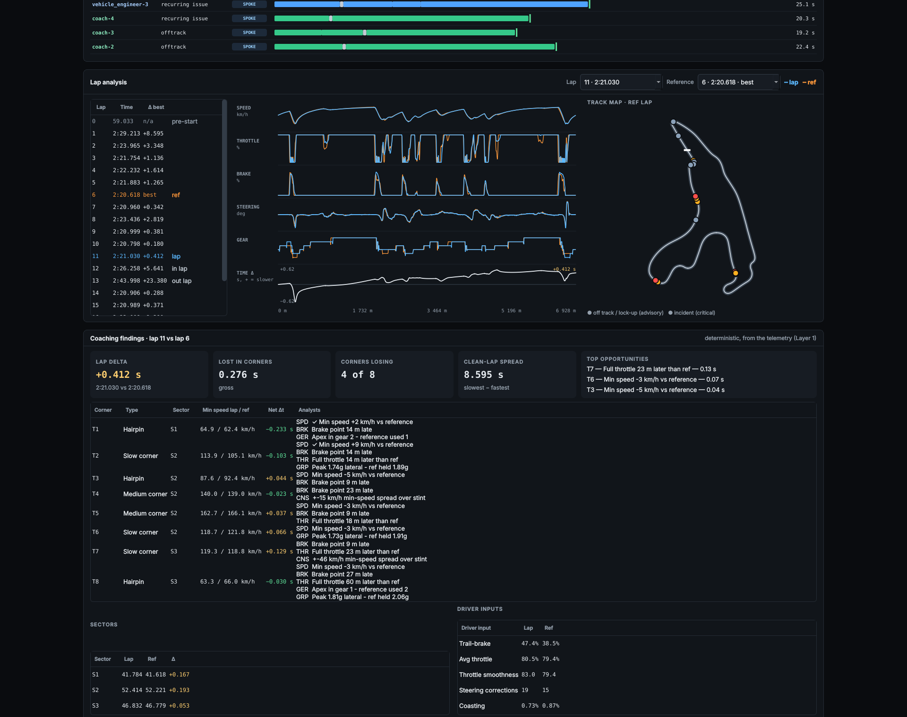
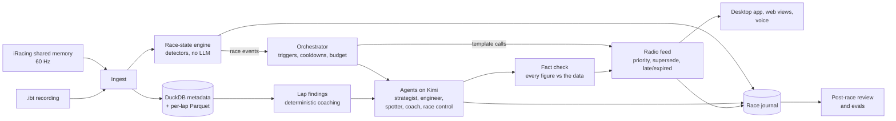

# Racing Telemetry Visualiser

**A live AI pit crew for iRacing.** RTV reads a car's telemetry 60 times a second, works out
the race state with plain code, and wakes five LLM agents (strategist, vehicle engineer,
spotter, driving coach and race control) only when something happens. They talk to the driver on one radio
channel, and every number they say is checked against the data before it is spoken. After
the race, a review replays everything the agents saw and said.

[](https://github.com/kruslim/racing-telemetry-visualiser/actions/workflows/ci.yml)


**[Open the live demo](https://kruslim.github.io/racing-telemetry-visualiser/)**: the post-race
review of a real 42-minute GT3 race at Spa, replayed with the AI agents on. It runs in the
browser from static files, so there is nothing to install.



---

## Why I built it

Sim racing tools tend to stop at one of two things: a database of laps and charts, or a
chatbot you can ask about them. A real race engineer does something harder. They watch the
race, keep quiet most of the time, and when they do speak the numbers are right.

That makes this a good test bed for a question that matters well beyond racing: **how do you
put LLM agents in a real-time loop and still trust what they say?** RTV's answer is to give
all the maths to deterministic code, let the models only explain and decide, and check
every figure they produce against the facts they were shown.

## Highlights

- **Real-time pipeline.** Live shared-memory capture at 60 Hz or offline `.ibt` import, stored
  as DuckDB metadata plus per-lap Parquet, and served over REST and WebSockets. The variable
  catalog is read from the telemetry header at run time, so it works for any car with no
  per-car mapping.
- **A race-state engine with no LLM in it.** Fuel, tyres, pit window, gaps and around 30 kinds of
  race event are computed by plain code. On the real Spa replay it averages about 0.1-0.2 ms
  per frame, against a 16.7 ms budget at 60 Hz.
- **Event-driven agents, not a chat loop.** Agents wake only when an event matches one of
  their triggers. In the recorded Spa replays a full 42-minute race used 25 to 44 model
  calls, under a hard cap of 400.
- **Every spoken number is fact-checked.** A deterministic validator reads each figure and
  its unit ("6 laps", "2.4 s", "P4") and matches it against the facts the agent was given.
  A figure it can't trace is sent back for one repair, and if it still fails the agent
  gives a grounded refusal instead of a guess.
- **One radio channel with rules.** Critical calls pre-empt advisories, a newer call on the
  same decision replaces a queued one, and a call that is out of date by the time it would
  air is tagged late or dropped.
- **Measured, not just demoed.** Every run is written to a race journal. A run-comparison
  script, replayable eval cases cut from a real race, an LLM judge on a second model family
  (Gemini) and a weekly scheduled eval track whether a change made the agents better or
  worse.
- **Native desktop app.** RTV Desktop (PySide6/Qt) embeds the server and is the main UI, with
  local push-to-talk questions (faster-whisper, no audio leaves the PC).
- **Tested offline.** Over 1,400 tests run with no game, no network and no API key, on
  Python 3.11-3.13 in CI, plus a job that runs the real 162 MB race file end to end.

## What it looks like

| Live pitwall | Lap analysis |
|---|---|
|  |  |
| Strategy, fuel margin, pit window, tyres and the radio during a replay of the Spa `.ibt`. This capture has the agents off, so it shows only what the deterministic engine produces. | Two laps compared on lap distance, with a time-delta curve, the track map and the corner-by-corner findings that every AI layer is grounded on. |

## How it works



1. **Ingest.** Frames come from iRacing's shared memory or a recorded `.ibt` file. A replay
   goes through exactly the same per-frame path as live capture.
2. **Race state.** Detectors turn the frames into typed race events (a lock-up, the pit window
   opening, fuel going critical). Repeated small events are aggregated in code first, so one
   lock-up wakes nobody but the same lock-up at the same corner three times in five laps does.
3. **Agents.** Each agent is a prompt, a small set of read-only tools, its triggers and a
   structured output schema. Calls whose wording is fully set by the event (a yellow flag, a
   car alongside) are templates with no model call at all.
4. **Fact check and radio.** The validator checks every figure, then the radio decides what
   airs and when.
5. **Journal and review.** Every event, agent input, tool call, verdict and radio call is
   journaled. The review plays that journal back and never re-runs the agents.

The post-race coaching side has its own layers: deterministic lap findings, an MCP server, a
multi-agent coach (fan out per corner, synthesise, verify) and a LangGraph coach that refuses
questions the telemetry can't answer. The [design doc](docs/DESIGN.md) covers all of it.

## Results so far

All numbers come from recorded replays of one real race (Audi R8 LMS EVO II GT3, Spa, 19
laps, about 152,000 frames), run through the full system with the agents on Kimi. They are
single runs, so treat small differences as noise.

| What | Result |
|---|---|
| Model calls per race | 75 in the first run, then 25-44 after fixes (budget 400) |
| Spotter calls moved to templates | model calls 34 to 25 and late radio calls 14 to 7, against the run before |
| Median model call | about 8-18 s depending on endpoint load, which is why time-critical calls are templates |
| Fact-check failures (latest recorded run) | 4 of 27 checks, with 1 refusal in 26 agent runs |
| Coaching plans graded by Gemini (5 real lap pairs) | 4.8 clarity, 4.6 actionability, 4.8 grounding, out of 5 |
| Strategy | called the stop on lap 12, the lap the real driver pitted |

Known limits: the only real data so far is one single-car `.ibt`, which has no other cars in
it, so standings and traffic calls are tested on generated sessions only. The live path has
not yet run against a full live iRacing field. Details are in the [design doc](docs/DESIGN.md#limitations-and-next-steps).

## Tech stack

| Area | Tools |
|---|---|
| Backend | Python 3.11+, FastAPI, uvicorn, WebSockets, Pydantic, pydantic-settings |
| Telemetry and data | pyirsdk, DuckDB, PyArrow/Parquet, NumPy, orjson |
| AI | Kimi Code (`kimi-k3`) through the Anthropic Messages format, LangGraph, FastMCP, Gemini as eval judge, faster-whisper for local speech-to-text |
| UI | PySide6/Qt desktop app; vanilla JS and canvas web views (no build step), browser speech synthesis |
| Quality | pytest (offline), ruff, GitHub Actions on 3 Python versions, a golden file shared by the JS and Python view models |

## Try it

The quickest look is the [live demo](https://kruslim.github.io/racing-telemetry-visualiser/).
To run it yourself (Windows; the server also runs on macOS and Linux for `.ibt` files):

```powershell
uv venv .venv --python 3.12
uv pip install --python .venv\Scripts\python.exe -r requirements-dev.txt -e .
.venv\Scripts\python.exe scripts\fetch_fixtures.py   # the real Spa race, 162 MB, checksummed
.\run.ps1                                              # http://127.0.0.1:8000, API docs at /docs
```

Open http://127.0.0.1:8000/review/ and import `tests/fixtures/real/audir8lmsevo2gt3_spa_race.ibt`,
or replay it through the live path with `POST /api/v1/replay/start`. The store starts empty, and
nothing generated is ever served. For the desktop app:

```powershell
uv pip install --python .venv\Scripts\python.exe -e ".[desktop]"
.\run-desktop.ps1
```

Everything except the agents works with no key. To turn the agents on, put a Kimi Code key in
`KIMI_CODE_API_KEY` and set `RTV_PITWALL_AGENTS=true` (see `.env.example`). Run the tests with
`.venv\Scripts\python.exe -m pytest`; they need no key and no network.

## Documentation

| Doc | What's in it |
|---|---|
| [DESIGN.md](docs/DESIGN.md) | System design: architecture, data flow, the agent design, trade-offs, and answers to common technical questions |
| [PITWALL.md](docs/PITWALL.md) | The live pitwall in depth, with a build log of every stage |
| [COACHING.md](docs/COACHING.md) | The four coaching layers |
| [DESKTOP.md](docs/DESKTOP.md) | RTV Desktop: running, building `RTV.exe`, push-to-talk |
| [VISION.md](docs/VISION.md) | Onboard video synced to telemetry, and VLM visual notes |
| [TRACKS.md](docs/TRACKS.md) | Corner names for 33 GT3 venues from OpenStreetMap |
| [WEEKLY_EVAL.md](docs/WEEKLY_EVAL.md) | The weekly live eval |
| [API.md](docs/API.md) | REST and WebSocket reference |
| [VARIABLES.md](docs/VARIABLES.md) | The iRacing variable set and type system |

## Project layout

```
src/rtv/
  catalog/  ingest/  store/  stream/  api/   telemetry in, storage, REST and WebSockets
  racestate/                                 deterministic race-state engine and events
  pitwall/                                   agents, fact check, radio, voice
  coaching/                                  lap findings, multi-agent and LangGraph coaches
  vision/  tracks/  director/                onboard video, corner names, race director seam
  desktop/                                   RTV Desktop (PySide6)
  llm.py                                     the one Kimi client every LLM layer uses
mcp_server/   the coaching MCP server
evals/        eval harness, real-race cases, LLM judge, test-only generated sessions
frontend/     web views (live, review, radio); docs/ holds the GitHub Pages copy
tests/        the offline pytest suite
```

## License

MIT. The Spa race data in the demo is from
[SVappsLAB/iRacingTelemetrySDK](https://github.com/SVappsLAB/iRacingTelemetrySDK) under
Apache-2.0 (see [docs/data/README.md](docs/data/README.md)). Corner names are from
OpenStreetMap (ODbL).
