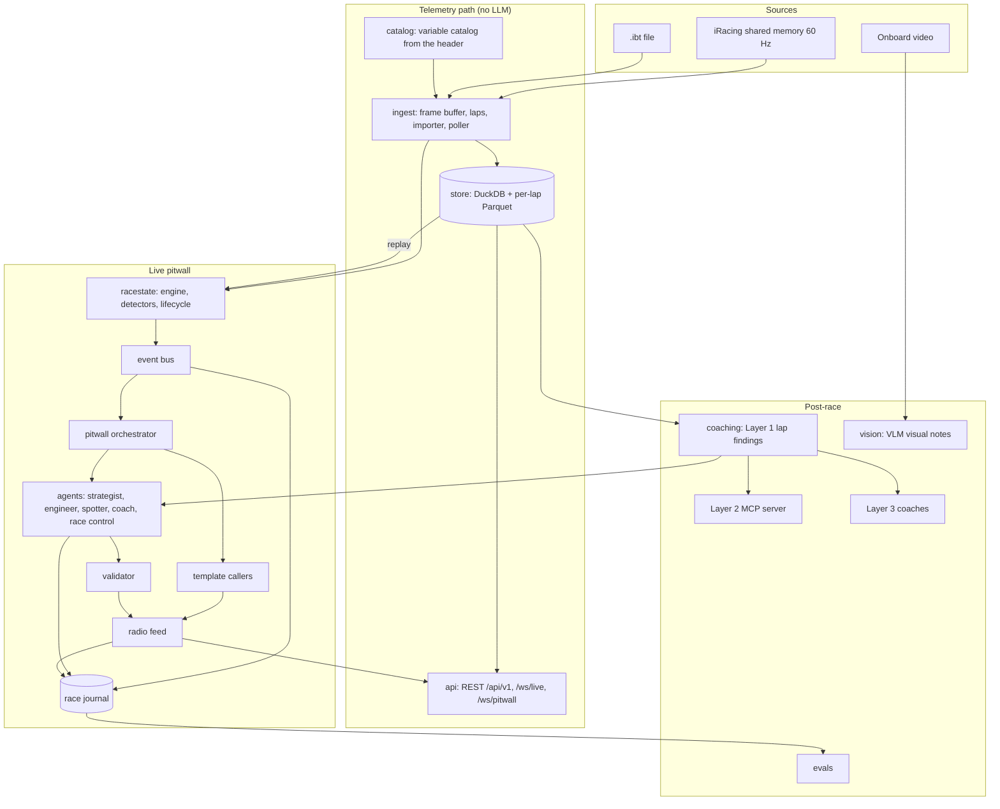

# RTV system design

This is the one document to read to understand how Racing Telemetry Visualiser (RTV) is put
together and why. It covers the goals, the architecture, how data moves through it, how the
AI agents are designed and kept honest, how they are evaluated, the main trade-offs, and
answers to the technical questions people usually ask. The deeper per-area docs are linked
where they apply. Status: active, describes `main` as of November 2026.

## Contents

1. [Context and goals](#1-context-and-goals)
2. [Architecture at a glance](#2-architecture-at-a-glance)
3. [Telemetry path: ingest, storage, streaming](#3-telemetry-path-ingest-storage-streaming)
4. [The race-state engine](#4-the-race-state-engine)
5. [The live pitwall agents](#5-the-live-pitwall-agents)
6. [Keeping the agents honest](#6-keeping-the-agents-honest)
7. [The radio channel](#7-the-radio-channel)
8. [Post-race coaching layers](#8-post-race-coaching-layers)
9. [Vision: onboard video and a VLM](#9-vision-onboard-video-and-a-vlm)
10. [Journal, review and the public demo](#10-journal-review-and-the-public-demo)
11. [Evaluation](#11-evaluation)
12. [User interfaces](#12-user-interfaces)
13. [Cost and latency](#13-cost-and-latency)
14. [Testing and CI](#14-testing-and-ci)
15. [Key decisions and alternatives](#15-key-decisions-and-alternatives)
16. [Limitations and next steps](#limitations-and-next-steps)
17. [Technical questions and answers](#17-technical-questions-and-answers)

---

## 1. Context and goals

iRacing exposes about 275 telemetry channels at 60 Hz through Windows shared memory, and
writes the same data to `.ibt` files. A human race engineer turns that stream into a few
well-timed sentences: "box this lap", "you're locking the front left into T1, brake a bit
earlier". RTV tries to do the same with LLM agents, and to show that it can be done without
the agents making numbers up.

**Goals**

- Capture every channel, live or from a file, for any car, with nothing hard-coded per car.
- Store it so a chart query for one lap reads one or two small files.
- Compute the race state (fuel, tyres, pit window, gaps, flags, incidents) deterministically,
  fast enough to run on every frame.
- Put LLM agents on top that speak only when something happens, on one radio channel, with
  every figure traceable to the data they were shown.
- Record everything so a race can be reviewed, compared with another run, and turned into
  regression tests.
- Keep the whole test suite offline: no game, no network, no API key.

**Non-goals**

- Not a replacement for a full telemetry analysis tool such as MoTeC. The lap analysis is
  there to ground the coaching, not to cover every analysis workflow.
- No fake data at run time. Generated sessions exist only as test fixtures
  (`evals/synthetic_*.py`); the app serves, replays and exports only real recordings.
- No LLM in the per-frame path. Models never see raw 60 Hz telemetry.
- No multi-user or cloud deployment. It is a single-driver tool that runs on the sim PC.

## 2. Architecture at a glance

The code is one Python package, `src/rtv/`, with one FastAPI app (`main.py`, wired in
`services.py`). Every LLM call in the app goes through one module, `llm.py`.

| Package | Role |
|---|---|
| `catalog/` | Builds the typed variable catalog from the telemetry header |
| `ingest/` | Frame buffer, lap detection, `.ibt` importer, live poller |
| `store/` | DuckDB schema, Parquet writer, query builders, race journal |
| `stream/`, `api/` | Live fan-out hub, REST routes, WebSockets |
| `racestate/` | Race-state engine, detectors, session lifecycle, event bus, replay |
| `pitwall/` | Agent framework, tools, validator, radio, templates, driver questions, TTS |
| `grounding/` | Reading numbers with units from prose; shared by both fact checks |
| `coaching/` | Layer 1 lap findings, Layer 3a orchestrator, Layer 3b LangGraph coach |
| `vision/` | Video sync, frame capture, VLM visual notes |
| `tracks/` | Corner names for 33 GT3 venues from OpenStreetMap |
| `director/` | The scripted race director: seam, scheduler and overlay (eval rehearsals only) |
| `desktop/` | RTV Desktop, the PySide6 client |

## 3. Telemetry path: ingest, storage, streaming

**Runtime catalog.** The channel list is read from the binary telemetry header each session,
not from a hand-written list. Each variable gets its type (six wire types: char, bool, int,
bitfield, float, double), unit, description, array shape and, for bitfields and enums, a
decode table. Arrays of up to six entries are flattened to `Name_0..n`; the 64-entry
per-car arrays (`CarIdx*`) become DuckDB `LIST` columns. Because the catalog comes from the
header, a new car or a new iRacing build needs no code change. `GET /variables` is the
contract every UI reads.

**Two sources, one path.** The live poller reads shared memory at `RTV_POLL_HZ` (60 by
default). The `.ibt` importer reads files in tick-window chunks as an async job, on any OS.
Both produce the same frames. A stored session can be replayed through the live path at any
speed: the replay driver calls the same `engine.on_frame` the poller calls, so the engine
cannot tell a replay from a live race. That one decision makes the whole live system
testable and reproducible from files.

**Storage.** Metadata (sessions, laps, catalog, session-info snapshots, import jobs) lives in
DuckDB tables. The high-rate telemetry is written as Parquet partitioned by session and lap
(`session_id=<uuid>/lap=<n>/part-*.parquet`). A chart asks for a few channels of one or two
laps, so it reads one or two small columnar files. Queries can downsample (`max_points`,
min/max mode so spikes survive) and align two laps on lap distance for comparison.

**Streaming.** `/ws/live` sends only the latest frame at each client's requested rate. A
slow client gets the newest sample, never a growing backlog, so one slow tab cannot lag the
others or grow memory. `/ws/pitwall` sends race-state snapshots the same latest-wins way,
but race events and radio calls are pushed immediately and never coalesced, because
dropping a "box now" to save bandwidth would be wrong.

## 4. The race-state engine

`racestate/engine.py` keeps one `RaceState`: session and flags, player position and laps,
a fuel model (per-lap use with spread, laps of fuel, margin to the finish), tyres
(temperatures, pressures, wear, trends), car health, standings and gaps, conditions, and a
pit window with its bounds. A number that has no channel behind it stays `None`, and a
capability flag says why; the UI shows `n/a`, never a misleading `0.0`.

**Detectors** are pure functions over a window of frames. The engine latches them into typed
`RaceEvent`s (32 types: flags, laps and bests, lock-ups, wheelspin, off-tracks, incidents,
pit entry and exit, stints, pit window, fuel margin, rivals, blue flags, tyre bands, car
health, traffic, a car alongside, weather, visual observations and session lifecycle).
Events carry session time, not wall-clock time, so a replay produces the same event log
twice.

**Aggregation happens in code.** One lock-up is a driver having a moment. A
`recurring_issue` event fires when the same issue happens at the same place three times
within five laps, and that is what wakes the coach. Each event that happened somewhere on
the lap carries a place label (`T1 La Source`) from a corner map built from the session's
own laps and the OpenStreetMap corner names.

**Session lifecycle.** The engine follows iRacing's session number and state through
practice, qualifying and race. Each session segment gets a clean engine, a reset agent layer
and its own journal run. With `RTV_PITWALL_AUTONOMOUS=true` the agents arm at the green flag
and stand down when the player takes the chequered flag; on the real Spa file that is
t = 79.4 s and the end of the player's race.

**Speed.** On a generated 3,360-frame scenario the engine averaged 0.03 ms per frame (max
0.24 ms). On the real Spa replay the UI reports about 0.1 to 0.2 ms. The frame budget at
60 Hz is 16.7 ms. The engine is also built to survive: a frame that raises costs that frame
and is counted, and `GET /pitwall/health` says whether frames are still arriving.

## 5. The live pitwall agents

### An agent is configuration

An agent in `pitwall/framework.py` is four things: a role prompt, a set of scoped read-only
tools, the triggers that wake it, and a Pydantic output contract. `AgentRuntime` is the only
code that calls a model. Adding an agent is an `AgentSpec` literal plus a prompt.

| Agent | Woken by (examples) | Tools (examples) | Says |
|---|---|---|---|
| Strategist | pit window opens or closes, fuel margin low, fuel critical, flags, stint milestones | fuel projection, stint history, simulate a pit stop, standings | when to stop, how much fuel, where you rejoin |
| Vehicle engineer | car health, tyres out of band, recurring issues | tyre trend, car health, setup snapshot, corner detail | car condition, whether a stop is needed for damage or tyres |
| Spotter | lap-line summaries when a car is within 5 s | standings, recent events | traffic picture (per-event spotter calls are templates) |
| Coach | recurring issues, off-tracks, stint milestones | corner detail (with the Layer 1 findings), recent events | one driving correction at a time |

### When the agents run

Agents are woken by race events, never on a timer and never per frame. The orchestrator
routes each event to the agents whose triggers match, and applies, per agent, a cooldown and
a one-slot latest-wins inbox (a queued critical event is never displaced by a lesser one),
and globally, a cap on concurrent calls (`RTV_PITWALL_MAX_INFLIGHT`, 2) and a hard budget
(`RTV_PITWALL_MAX_CALLS_PER_SESSION`, 400, shared with the live VLM). A supervisor restarts
crashed workers and says so, and an agent whose provider fails three times in a row is taken
off the air instead of paying for doomed calls.

### Templates instead of models where the words are fixed

Some calls are fully determined by their event: "Car left.", "Clear.", "Yellow flag",
"Blue flag, P1 lapping you, 1.2 behind." A model call takes 8 to 18 s, which is far too slow
for a car alongside. These are `DeterministicCaller` templates that publish to the radio in
the same tick with no model call. Every figure is copied from the event payload, and the
tests run each template through the validator to prove it is grounded. Moving the spotter's
per-event calls to templates cut a Spa replay from 34 to 25 model calls and its late calls
from 14 to 7.

### What an agent sees

Each run starts with a prefetch of the tools its trigger always needs, so most agents answer
in one model call. The prompt holds the relevant slice of the race state, the triggering
event, the last five radio calls for context, and the agent's own recent calls on the same
subject with their outcome (aired, late, expired, superseded). Showing an agent what it
already said makes it revise rather than repeat itself. Speeds are given to agents in km/h
(the engine keeps m/s internally) after a real run showed agents quoting m/s values as km/h.

### Driver questions

The driver can type a question or, in the desktop app, hold a key and speak it
(faster-whisper, on the local CPU). A router answers lookups (fuel laps, gaps, lap times,
position, laps to go, tyre temperatures) straight from the engine with a template, and sends
anything else to the agent that owns the subject as a `driver_question` event.

### The LLM provider

Every agent uses Kimi Code (`kimi-k3`) through `rtv.llm`. The endpoint speaks the Anthropic
Messages format, so the `anthropic` SDK is only the transport. Structured answers come from
forcing a single `respond` tool whose input is validated against the output contract; the
endpoint does not implement the SDK's native structured-output parsing, and `kimi-k3` needs
thinking turned off to accept a forced tool choice. A trial of the other models on the same
key (`k3`, `k3-256k`, `k3.1-pro`, `kimi-for-coding` and its highspeed variant) found none
faster for this workload with reliable forced tool calls, so every agent stays on `kimi-k3`.
Per-agent model settings exist (`RTV_PITWALL_<AGENT>_MODEL`) if that changes.

## 6. Keeping the agents honest

The rule: **an agent may not say a number that is not traceable to deterministic data.**

**The validator** (`pitwall/validator.py`) collects every numeric fact the agent was shown
(the race-state slice, the event, every tool result) into a `FactSet`, then reads every
figure in the agent's output. With typed grounding (on by default), each fact carries its
unit family and path (`fuel.laps_remaining = 6.2 laps`), and a figure said with a unit
("6 laps", "2.4 s", "P4", "28 psi", "three tenths") must match a fact of the same family,
with unit conversion inside a family. So a tyre pressure can no longer ground "laps of fuel"
by being numerically close. Rounding is allowed ("2.5 laps" for 2.487), and so is a
difference of two facts in the same sentence ("1.2 s quicker"). Spelled-out counts match
occurrence facts ("three laps running").

**Repair, then refusal.** A failing answer gets one repair turn that names the figures that
could not be traced. If it still fails, the message is withheld and the agent's run ends as a
grounded refusal, which the review shows with its reasons. The radio never airs an invented
figure.

**Checked again at air time.** An answer is computed from a snapshot that can be 15 to 60 s
old when it reaches the front of the queue. Each radio call carries a validity rule (valid
until lap N, invalid once past a lap distance or once on pit road, about car X). At air time
the rule is checked against the current state: a call still true but older than its agent's
limit airs as "Late call: ...", and a call that has become false is dropped and journaled as
expired.

**Post-race prose check.** The coaching plans get a matching deterministic check
(`coaching/agent/prose.py`): every distance, speed, gear, time, g value and brake direction in
the prose is compared with the Layer 1 findings, and failures are listed with the plan rather
than hidden. This was added after the model-based verifier accepted a brake point moved the
wrong way on a real lap.

## 7. The radio channel

A driver has one pair of ears, so the pitwall has one channel (`pitwall/radio.py`):

- Priority, then time. A critical call pre-empts what is queued.
- Supersede. Two queued advisories on the same subject become one; the newer wins.
- One answer per decision. The strategist's pit calls and the engineer's "box now for damage"
  are one decision (`pitwall/decisions.py`). The newer call replaces a queued one from either
  agent, and a call that contradicts a standing higher-priority one is dropped.
- Critical calls are never superseded.
- Airtime. A call occupies the channel for about as long as it takes to say.
- Late and expired, as above.

The radio is spoken by the browser's speech synthesis (a voice per role, a click before
critical calls, critical calls interrupt advisories) or a backend TTS provider. The queue
rules are a pure module with their own tests.

## 8. Post-race coaching layers

| Layer | Code | What it does |
|---|---|---|
| 1. Lap findings | `coaching/features.py`, `GET /coaching/lap-findings` | Aligns a lap and a reference on lap distance, finds corners as speed minima, builds a time-delta curve and runs eight diagnostics (speed, brake point, lock-up, throttle, gear, grip, consistency, sector) plus driver KPIs. About a million points per lap become about 20 corner findings. |
| 2. MCP server | `mcp_server/telemetry_coach.py` | Six tools over the REST API, so an MCP client can coach from the same findings. |
| 3a. Orchestrator | `coaching/orchestrator.py` | Code-controlled: one specialist per priority corner in parallel, a synthesis into a session plan, a model verifier, then the deterministic prose check. |
| 3b. Graph coach | `coaching/agent/` | A LangGraph agent (`agent -> tools -> validate -> refuse`) that drives the coaching tools itself, validates every figure in the loop, and refuses questions the session cannot answer (for example tyre temperatures that were never recorded), listing what is available instead. |

Layer 1 is the only implementation of the coaching heuristics. The UIs render it, the
agents read it through `get_corner_detail`, and the evals use it as ground truth. It is
both the token budget (the model reads a few KB, not a lap of telemetry) and the definition
of "correct".

## 9. Vision: onboard video and a VLM

`rtv.vision` syncs an onboard video to session time (by an offset, by lap-start crossings
seen in the video, or by anchor pairs) and asks a vision model to describe short frame
sequences around moments the telemetry already flagged (an off-track, a lock-up, an
incident). The rule is **telemetry picks the moment, the VLM describes it**: a visual note is
words about what the camera saw (kerbs, the line, other cars, damage) and must not carry a
figure. The notes appear in the review. A live mode captures the game window with ffmpeg and
runs the same analysis on event-triggered frames, inside the shared call budget; by default
live notes go to the review only and do not wake agents. Kimi's endpoint accepts image input,
so the VLM is the same model. No real onboard footage has been through it yet (see
limitations).

## 10. Journal, review and the public demo

Every session the engine consumes is written to a race journal
(`data/sessions/<id>/runs/*.jsonl`): race events, each agent run with its full input (system
prompt and hash, state slice, event, radio context, prefetched tool results, tools and
output schema), every tool call and result, the validator verdict and the reasons for any
failure, every radio call with its late or expired outcome, and the race state once a second.
The journal is versioned (schema 3).

The post-race review plays the journal back on one timeline: lanes for race events, each
agent and the radio, what the car was doing at the cursor, and the pitwall diagram at that
moment. It never re-runs the agents, so a review costs nothing and shows exactly what
happened.

The public demo on GitHub Pages is the web review in a static mode: `export_session.py`
writes the REST payloads of one real session (the Spa race with run 3's agents) as JSON
under `docs/data/spa/`, and the review reads them from there.

## 11. Evaluation

The eval stack answers one question: did this change make the agents better or worse?

| Tool | What it does | Cost |
|---|---|---|
| Hermetic harness (`evals/runner.py`) | Replays seeded coaching behaviours against a scripted model, checks figures against Layer 1, diffs against a baseline. Runs in pytest. | free |
| Pitwall cases (`evals/pitwall_cases.py`) | Generated race situations per agent, run through the real validator; includes swapped-fact cases that must fail. | free offline |
| Real-race cases (`evals/real/spa_run`) | Cases cut from a real Spa journal. Offline, recorded answers are re-scored with today's checks against `baseline.json`, so a validator change shows up as a reviewed diff. Live, the same inputs are re-run on Kimi. | free offline, paid live |
| Run comparison (`scripts/compare_runs.py`) | Compares two journals: calls, refusals, validator failures, untraceable numbers, late and expired calls, latency and tokens, per agent and per trigger. | free |
| LLM judge (`evals/judge_provider.py`) | Grades clarity, actionability and grounding. Defaults to Gemini so the grader is a different model family from the agents. | paid |
| Weekly eval (`scripts/weekly_eval.py`) | A scheduled run: a Spa replay, the real cases live, the golden sets and the coach eval, diffed against last week. | paid |

On five real Spa lap pairs, Gemini graded the coaching plans 4.8 for clarity, 4.6 for
actionability and 4.8 for grounding (out of 5). The same run showed a false positive in the
deterministic check (it did not accept corner names like "T7 Campus"), which was then fixed.
The judge is the only non-Kimi model, it lives in `evals/` only, and a test fails if anything
in `src/rtv/` imports it.

## 12. User interfaces

**RTV Desktop** (`rtv.desktop`, PySide6/Qt 6) is the main UI. It embeds the server, so there
is one thing to start, and builds to a single `RTV.exe`. It has the live pitwall, the radio,
the post-race review with lap analysis, the onboard video panel, and push-to-talk.

**Web views** (`frontend/`, vanilla JS and canvas, no build step) serve the live view at `/`,
the review at `/review/` and a radio page at `/radio.html` for a tablet. They are frozen to
bug fixes; the web review stays because the Pages demo is built from it.

The view logic (formatting, the view model, the activity model, the review) exists in both
JS and Python, so both are tested against one shared golden file of cases built from real
Spa payloads. A script rebuilds it and refuses to write while the two sides disagree.

## 13. Cost and latency

All continuous maths is deterministic, so the model bill scales with the number of events,
not frames. Recorded full-race replays of the 42-minute Spa race used 25 to 44 model calls
after the first run (which used 75), with about 50k input tokens, 60k cached tokens and
15-18k output tokens per race. Median call latency on the Kimi endpoint ranged from about
8 s to 18 s depending on load. That latency is why anything time-critical is a template,
why calls are checked again at air time, and why there is a late tag at all.

## 14. Testing and CI

- Over 1,400 offline tests: catalog and decoding, store round trips, laps, API, coaching,
  MCP server, orchestrator, evals, race-state engine, agents, radio, voice, director seam,
  vision, desktop view models and widgets.
- LLM layers are driven by scripted providers (`ScriptedModel` in `tests/conftest.py`), so the
  suite passes with or without a key.
- `tests/test_real_ibt.py` runs import, lap detection, coaching and replay-as-live on the real
  162 MB Spa file; CI fetches and caches it in its own job.
- `scripts/smoke_offline.py` drives the HTTP surface end to end.
- The JS modules have test runners that need only `node`; pytest runs them when `node` is on
  `PATH`.
- GitHub Actions runs ruff, pytest and the smoke test on Python 3.11, 3.12 and 3.13 for every
  push to main and every PR, plus the desktop widget tests offscreen and the real-file job.

## 15. Key decisions and alternatives

| Decision | Alternatives considered | Why this one |
|---|---|---|
| Deterministic race state, LLMs only on events | Stream telemetry to a model; poll a model every N seconds | Raw telemetry is about a million points per lap; per-tick calls would cost thousands of calls per race and still be slower than code at arithmetic. Events give 25-44 calls per race. |
| A deterministic validator for figures | A second LLM as a fact checker | A model verifier adds 8-18 s and can be talked round (it accepted a brake point moved the wrong way). A code check is instant, repeatable and testable. |
| Templates for fixed-wording calls | Prompt a fast model | No Kimi model on the key was fast enough for "car left"; a template is instant and grounded by construction. |
| Refuse rather than guess | Let the agent answer with caveats | A wrong fuel number on the radio is worse than silence. Refusals are visible in the review, so they can be fixed. |
| DuckDB plus per-lap Parquet | SQLite, a time-series database, one file per session | Embedded, no server, columnar; partitioning by lap means chart queries read tiny files. |
| Header-driven catalog | A curated channel list | Covers every car and future iRacing builds with no maintenance. |
| Replay through the live path | A separate offline analysis path | One code path means every live feature can be tested and demoed from a file. |
| Journal everything, review from the journal | Re-run agents for the review | Reviews are free, exact and reproducible, and journals become eval cases. |
| One LLM gateway (`rtv.llm`) | Each layer builds its own client | One place for the endpoint, key, model and quirks (forced tool, thinking off). |
| Judge on a different model family | Kimi grades Kimi | Self-grading is biased; in the judge run Kimi gave itself 5/5 and returned empty grades on 2 of 5 cases. |
| Native desktop app as the main UI | Keep extending the web pages | A sim racer runs one program on one PC; Qt gives a single window, local voice and a single `.exe`. |
| Event-triggered vision | Continuous video analysis | Same cost logic as the agents: telemetry already knows when something happened. |

## Limitations and next steps

- **One real recording.** All real-data results come from one single-car `.ibt` of a Spa
  race. An `.ibt` has no other cars' positions, so standings, gaps, traffic and blue-flag
  calls are tested on generated sessions only.
- **The live path has not run against a real live field.** A recorded live session with
  other cars (a planned rig session) is the next real-data step.
- **No real onboard footage** has been through the VLM; it has run on test patterns only.
- **Single runs.** Each replay result is one run on a shared endpoint, so small differences
  between runs are within noise.
- **Latency.** Model calls take 8-18 s, so agent advice is minutes-scale strategy and
  coaching, not instant reactions.
- **Pending build stages.** None: stages 08 (race plan), 09 (race control and the post-race
  debrief) and 10 are built and recorded in [PITWALL.md](PITWALL.md). The race director
  (stage 10) runs only from evals (`evals/run_director.py`), never in the app, and has
  not yet been rehearsed against Kimi.

## 17. Technical questions and answers

**Why not just give the telemetry to an LLM?**
A lap is about a million numbers. Models are slow and unreliable at arithmetic over that much
data, and it would cost a large number of tokens per lap. Code computes the fuel model, the
pit window and the corner deltas exactly; the model's job is to choose what matters and say
it well.

**How do you stop hallucinated numbers?**
Every figure in an agent's answer is read with its unit and matched against the facts that
agent was shown, by code, before the answer can air. One repair turn, then a refusal. See
[section 6](#6-keeping-the-agents-honest). The same check runs over the real-race eval cases,
so a regression shows up as a diff.

**Isn't a refusal a failure?**
It is a visible, explained one, which is the point. The review lists each refusal with the
figures that could not be traced, and fixing those causes (unit confusion, derived counts)
was the most productive source of improvements.

**What happens when the model is slow or down?**
Template calls and engine lookups do not need the model. Agent calls are checked again at
air time and tagged late or dropped. Three consecutive provider failures take an agent off
the air, the budget caps total calls, a kill switch stops spending without stopping capture,
and the health endpoint reports all of it. With no key, everything except the model agents
works.

**How do the agents coordinate?**
They do not message each other. They share the race state and the event bus, each sees the
last few radio calls as context, and the radio enforces one answer per decision. Keeping
coordination in deterministic rules makes it testable.

**Why event-driven rather than a single agent loop?**
Cost and focus. A single agent watching everything would be called constantly and would
have to decide what matters from raw state. Detectors and aggregation decide what matters
cheaply; each agent has a narrow job with narrow tools.

**How is it tested without iRacing or an API key?**
Replays go through the live path, LLMs are scripted in tests, generated sessions cover
multi-car situations, and the real `.ibt` covers real data. Over 1,400 tests run offline in
CI.

**How do you know a prompt or validator change helped?**
Replay the same race and compare the journals (`compare_runs.py`), re-score the real-race
cases against the baseline, and run the live eval with the Gemini judge. The weekly eval does
this on a schedule and writes a diff against the previous week.

**Why Kimi?**
It was the available subscription, its endpoint speaks the Anthropic Messages format, and it
accepts images, so one gateway covers the agents, the coaches and the VLM. All model access
is behind `rtv.llm`, so another provider is a change in one module.

**Why vanilla JS for the web views?**
No build step and no toolchain to maintain for a small, frozen set of pages. The view logic
is in plain modules with tests that need only `node`.

**How does the review stay accurate?**
It reads the journal, which records each agent's exact inputs. A model's input can be
rebuilt byte for byte from the journal, and drift between a recorded run and the current
prompt or tools is detected.

**What is the most interesting bug you found?**
In one replay agents quoted an off-track speed of "27.7" with km/h, but the engine reports
m/s (27.7 m/s is about 100 km/h). Typed grounding caught it as a unit mismatch and refused
the call. The fix was to give agents km/h values, not to loosen the check. Another: the
number parser read "seventy-two percent" as "two percent"; it was found by a real replay and
fixed before the next one.
